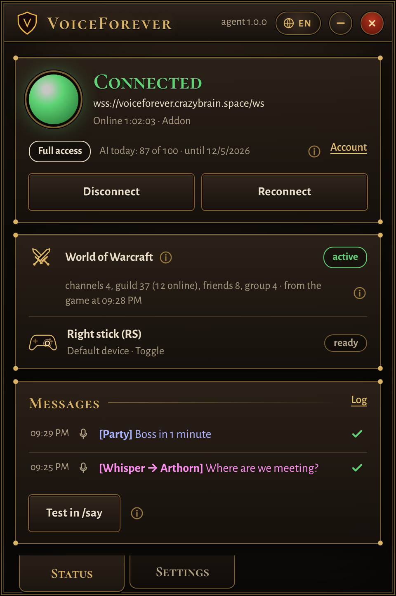
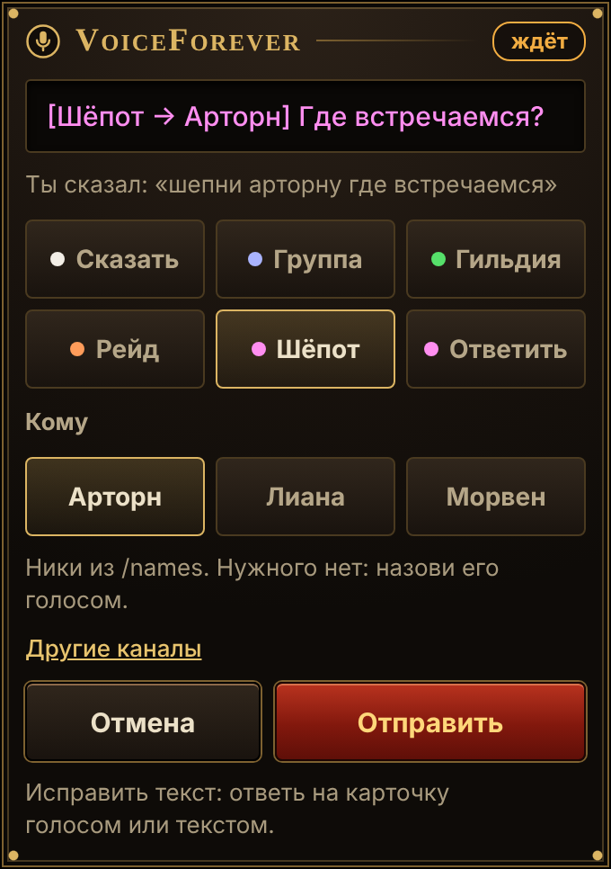
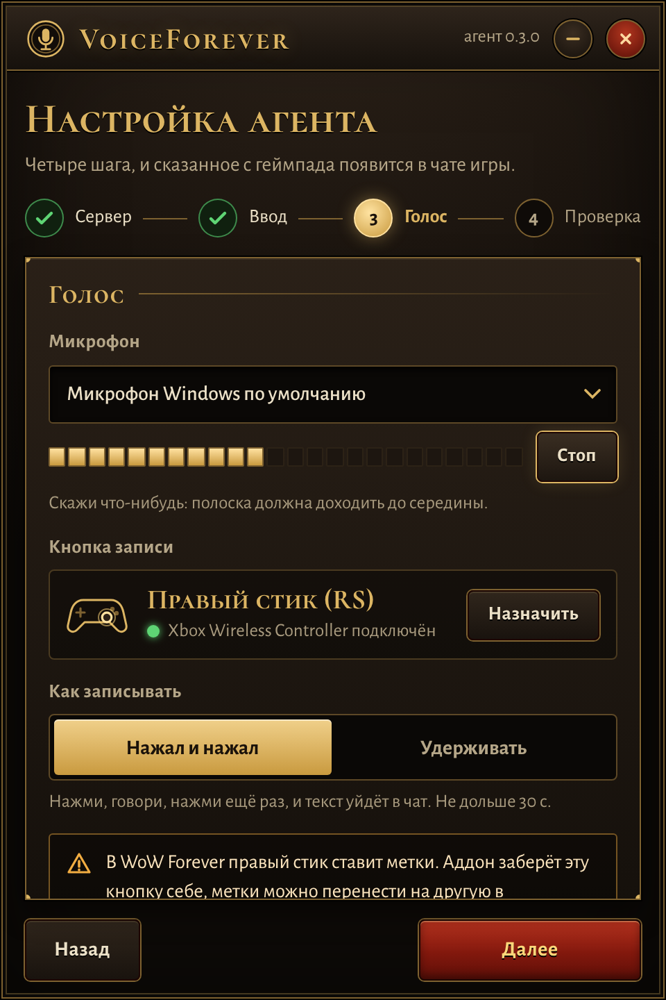
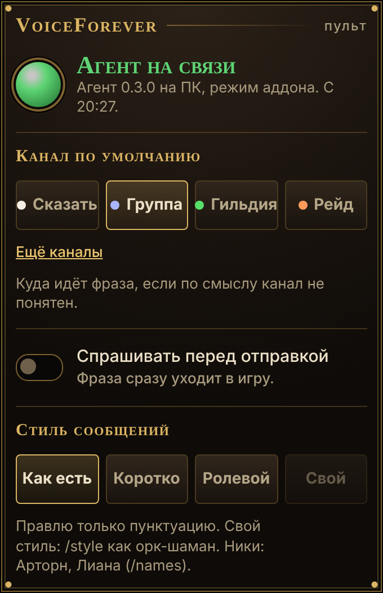

# VoiceForever

**Speak, and your message appears in the right World of Warcraft: Forever chat channel.**

Press a button on your gamepad, say what you want to write, and VoiceForever types it into the game: to your party, guild or raid, or as a whisper, with the punctuation fixed. No keyboard, no chat window, no picking the channel.

**[Get VoiceForever →][website]**

  
  &nbsp;
  

## Why

WoW Forever plays great on a gamepad, right up until someone asks you something in chat. Answering means putting the controller down, opening the chat, choosing the channel and typing, and in a dungeon there is no time for that. With VoiceForever you answer without letting go of the pad.

## How it works

1. **Press and speak.** Click the right stick (or any button you choose) on an Xbox or DualSense controller and say your message. A recording badge appears in the game. You can also send a voice message to the VoiceForever Telegram bot from your phone.
2. **VoiceForever works out where it goes.** Your speech becomes text, and Claude, Anthropic's AI, picks the channel from what you said: "tell the party…", "whisper Arthorn…", "reply…", "in trade…". It drops those words, fixes punctuation and recognition slips, and keeps your wording. If you name no channel, it carries on the conversation you were just having.
3. **It shows up in the game.** The VoiceForever app on your PC hands the message to a small in-game addon, which posts it without opening the chat window. The badge shows where it went.

| You say | In the game chat |
|---|---|
| "Party, boss in one minute" | [Party] Boss in 1 minute |
| "Tell the guild I'll be back in five minutes" | [Guild] Back in 5 minutes |
| "Whisper Arthorn, where are we meeting" | [To Arthorn] Where are we meeting? |
| "Reply: on my way" | [To whoever whispered last] On my way |
| "Trade, selling copper ore" | [2. Trade] Selling copper ore |
| "Okay, got it" (right after writing to the guild) | [Guild] Okay, got it |

## What you get

- **A Windows app** that sits in the tray while you play. It shows whether it is connected, sees your gamepad even when the game is in the background, and lists your last messages with a mark for each one that reached the game. Setup takes four steps: server, mode, voice and a check in the game.
- **An in-game addon.** The chat window never opens: the addon picks party, raid or instance chat by itself, replies to the last whisper and shows a recording badge. It also passes on your chat channels and the nicknames of your group, guild and friends, so names come out spelled as in the game and you can write to a channel by its name.
- **A Telegram bot** for voice messages from your phone. Every message gets a card with its channel and delivery status, and a pinned panel holds your default channel, confirmation, message style and language.

The app, the bot and the addon speak English, Russian, German, Spanish and French, and start in the language of your Windows, Telegram app and game client.

  
  &nbsp;
  

## Get started

Downloads and everything you need to start are on **[the VoiceForever website][website]**. The addon is also on [CurseForge](https://www.curseforge.com/wow/addons/voiceforever), so the CurseForge app installs and updates it.

### Host it yourself

You can also run the whole thing on your own server, with your own keys for Telegram, speech recognition and Claude. The [self-hosting guide](docs/README.md) covers the server, the addon and the app, and how to build them from source.

## Fair play

- The app types only when the WoW window is active, and only what you said. It does not read or change game memory and automates nothing in gameplay.
- A voice message cannot run a game command: VoiceForever strips a leading `/` or `.` and the `|` character from every message.
- Blizzard's rules forbid automating gameplay. Typing your own words is close to Windows voice typing, but Blizzard has not officially approved tools like this. Use it at your own risk.

## Contributing

Bug reports, ideas and pull requests are welcome: see [CONTRIBUTING.md](CONTRIBUTING.md). Report vulnerabilities privately, as described in [SECURITY.md](SECURITY.md).

## License

[GNU AGPL-3.0](LICENSE). Copyright (C) 2026 Kirill Kuzin.

You can use, change and self-host VoiceForever for free. If you run a changed version for other people, you must publish your changes under the same license.

[website]: https://voiceforever.crazybrain.space
