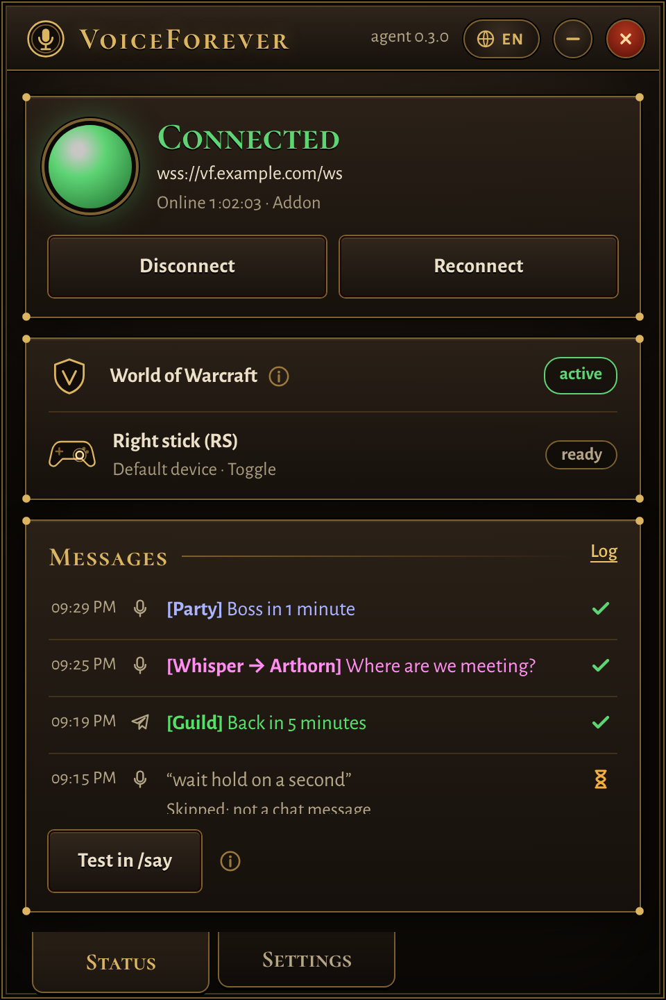
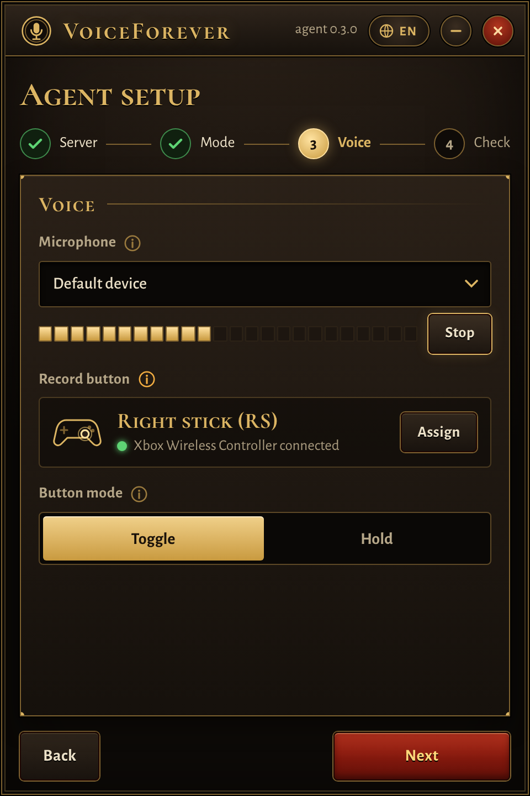
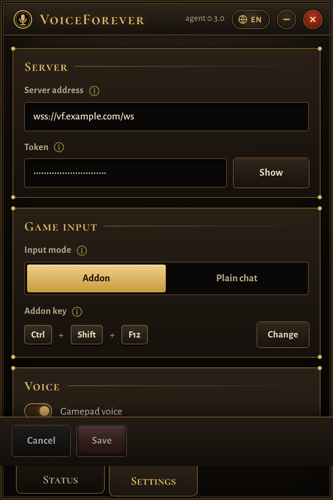

# The Windows app (agent)

The agent is a small Windows app that stays connected to your server and types messages into the game window: it presses the addon's hotkey, pastes the line and presses Enter. On a gamepad button it records your microphone and sends the recording to the server. It never reads game memory.

Windows 10 or 11, 64-bit.



## Install

Download `VoiceForeverAgent.exe` from [Releases](https://github.com/kirillkuzin/VoiceForever/releases) and run it. The exe is not signed, so Windows may show SmartScreen: "More info" → "Run anyway". Checksums are in `SHA256SUMS.txt` next to the exe.

The window needs the Microsoft Edge WebView2 Runtime. Windows 11 already has it, and on Windows 10 it usually comes with Edge; if it is missing, the agent tells you where to download it.

## First run

On first launch a four-step setup opens:

1. **Server**: the server address `wss://<domain>/ws` and the agent token (the part after the colon for your Telegram ID in `VF_USERS`). The agent checks the connection right away.
2. **Mode**: with the VoiceForever addon (recommended) or plain chat.
3. **Voice**: the microphone, with a level meter, and the gamepad button that starts recording.
4. **Check**: the in-game check of the button (see below) and a test phrase.



After that the window has two tabs:

- **Status**: whether the agent is connected, with disconnect, reconnect and connect buttons; whether the game window is active; the gamepad and recording state; the last messages, each marked with whether it reached the game. "Test in /say" types a test line.
- **Settings**: everything in `config.toml` (server, token, input mode, addon key, voice, game window, typing delays, language). The ⓘ icon next to a setting explains it. **Detect automatically** finds the WoW window and process for you. If you change the address, the token or the mode, the agent reconnects by itself.



## Voice from the gamepad

Xbox and DualSense controllers work, over USB or Bluetooth, and the agent sees them even when the game window is in the background. By default clicking the right stick starts recording:

- **Toggle** (`ptt_mode = "toggle"`): press, speak, press again. A recording never runs longer than `max_record_s` (30 s); then it is sent by itself.
- **Hold** (`ptt_mode = "hold"`): you speak while you hold the button.

Recording starts only while the WoW window is active. Anything shorter than 0.3 s counts as an accidental press and goes nowhere. The agent beeps at the start and the end (`ptt_sounds`), the tray icon turns red while recording, and the addon shows a badge in the game: "recording", then "recognising", then where the text went. You can drag the badge with the mouse.

The addon takes the button over: in WoW Forever the right stick places pings, and without this the game would place a ping on every recording. The last setup step ("in-game check", also available in the settings) hands the button to the addon: the game asks you to press it, the addon remembers what was bound to it and reloads the interface, and the agent shows the result. You can move the previous action to another button in the game's controller settings. Without the addon (`mode = "chat"`) the game gets the press too, so pick a button that does nothing in the game.

The server recognises the speech the same way as Telegram voice messages, and Claude picks the channel the same way. The server accepts recordings up to `VF_MAX_VOICE_S` (60 s).

The agent reads the gamepad and the microphone through [SDL3](https://libsdl.org) (zlib license); `SDL3.dll` is already inside the exe. Gamepad voice works in the windowed app only; `--headless` does not enable it.

## Language

The window, the tray and the messages speak English, Russian, German, Spanish and French. The agent starts in the Windows display language (English if it is none of these) and you can switch it with the globe button in the title bar or in Settings → App. In `config.toml` it is `language = ""` (follow Windows) or one of `en`, `ru`, `de`, `es`, `fr`.

## Tray

The close button hides the window to the tray, and the agent stays connected. The tray icon shows the state by colour, right-click opens a menu, and you get a notification when the connection drops. Starting the exe a second time just opens the running window. You can start the agent with Windows: it then starts minimised to the tray.

## Settings file

Settings live in `%APPDATA%\VoiceForever\config.toml` (or next to the exe, if a `config.toml` is already there), and the log in `agent.log` in the same folder. You can edit the file by hand; every setting has a comment.

## Without the addon

Pick "plain chat" (`mode = "chat"`): the agent opens the normal chat and types `/p`, `/g`, `/w` itself.

## Command line

- `VoiceForeverAgent.exe --headless` runs without a window, logging to the console.
- `--test` types a test line in /say and exits.
- `--config <path>` uses another settings file.

## From source

You need [uv](https://docs.astral.sh/uv/) (`winget install astral-sh.uv`). It downloads Python 3.15 and the exact library versions from `agent/uv.lock` by itself:

```
cd agent
uv run python -m vf_agent
```

For voice, put `SDL3.dll` from [`SDL3-3.4.8-win32-x64.zip`](https://github.com/libsdl-org/SDL/releases/tag/release-3.4.8) into the `agent` folder (or point the `VF_SDL3` environment variable at it). To build the exe yourself: `agent\build.bat` → `agent\dist\VoiceForeverAgent.exe`.
