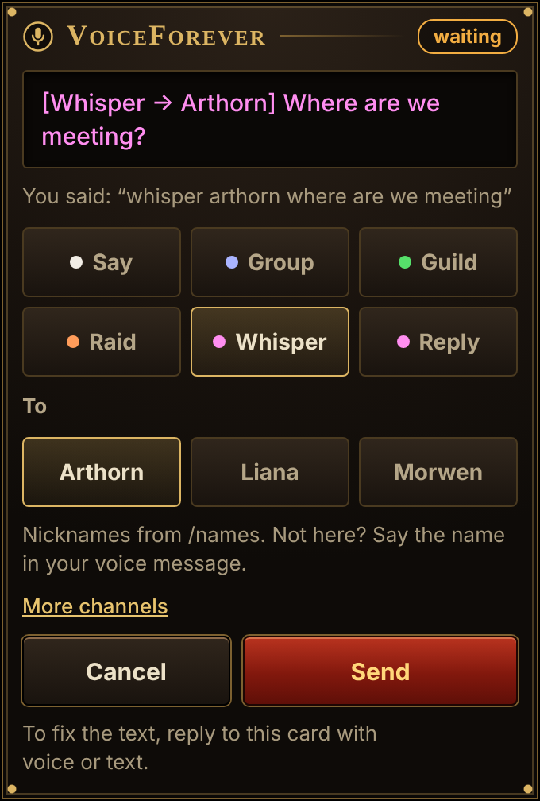
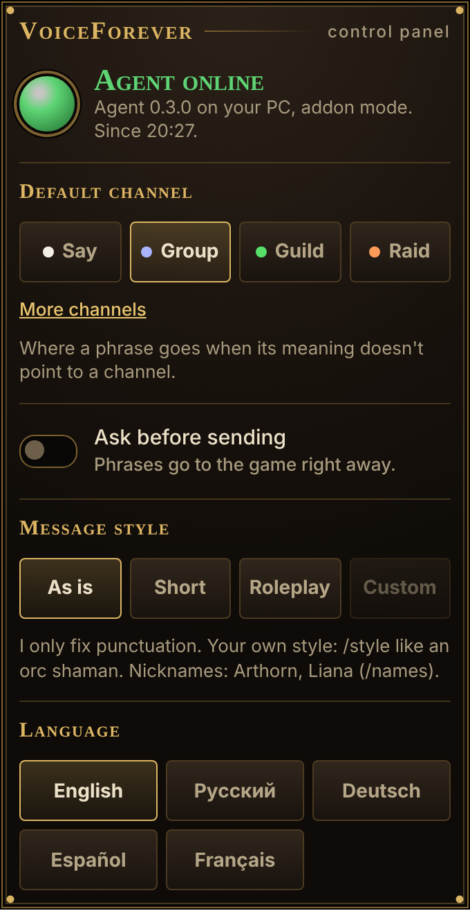
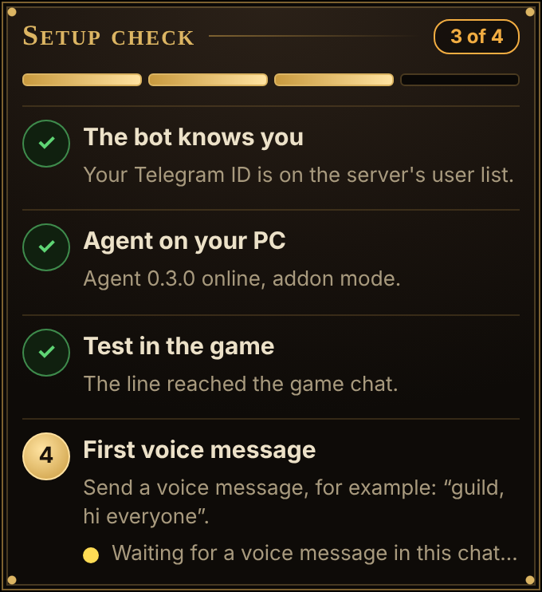

# The Telegram bot

Send the bot a voice message and it types it into the game chat through the Windows app on your PC. Text messages work too, which is handy for testing.

## Commands

| Command | What it does |
|---|---|
| `/status` | whether the Windows app is connected, and your current settings |
| `/channel group\|guild\|say\|raid` | the default channel, used when the phrase names none (channel names in any of the bot's languages work too) |
| `/confirm on\|off` | show the message with buttons before sending it |
| `/style like an orc shaman` | rewrite messages in a style (or "translate to English"); `/style off` turns it off |
| `/names Arthorn, Liana` | character names you mention often (helps recognition) |
| `/panel` | pin the control panel: app connected or not, channel, confirmation, style, language |
| `/widgets on\|off` | cards and the panel, or plain text buttons |
| `/language` (or `/lang`) | the bot's language: English, Russian, German, Spanish or French |

Without a channel in the phrase, Claude continues the conversation in the channel you used in the last 5 minutes, otherwise it takes the default channel.

## Widgets

The bot answers with HTML widgets right in the chat (Bot API 10.4, so far only in a private chat with the bot):

- **Message card** under every voice message: the phrase in the game's channel colour, a choice of channel and of the name for a whisper, and the status "sending", "in the game" or "not sent" with a retry button. To correct the text, reply to the card with voice or text.
- **Control panel** (`/panel`) is pinned at the top of the chat and updates itself when the app connects or disconnects. It also switches the default channel, confirmation, message style and language.
- **Setup checklist** comes on `/start`: the bot knows you, the app is connected, the test line reached the game, the first voice message.

  
  
  

The bot answers in the language of your Telegram app (English if it is none of the five) until you pick one with `/language` or on the panel. The widgets follow the same choice.

If your Telegram app does not show widgets, turn them off with `/widgets off`: the bot goes back to text with buttons.
